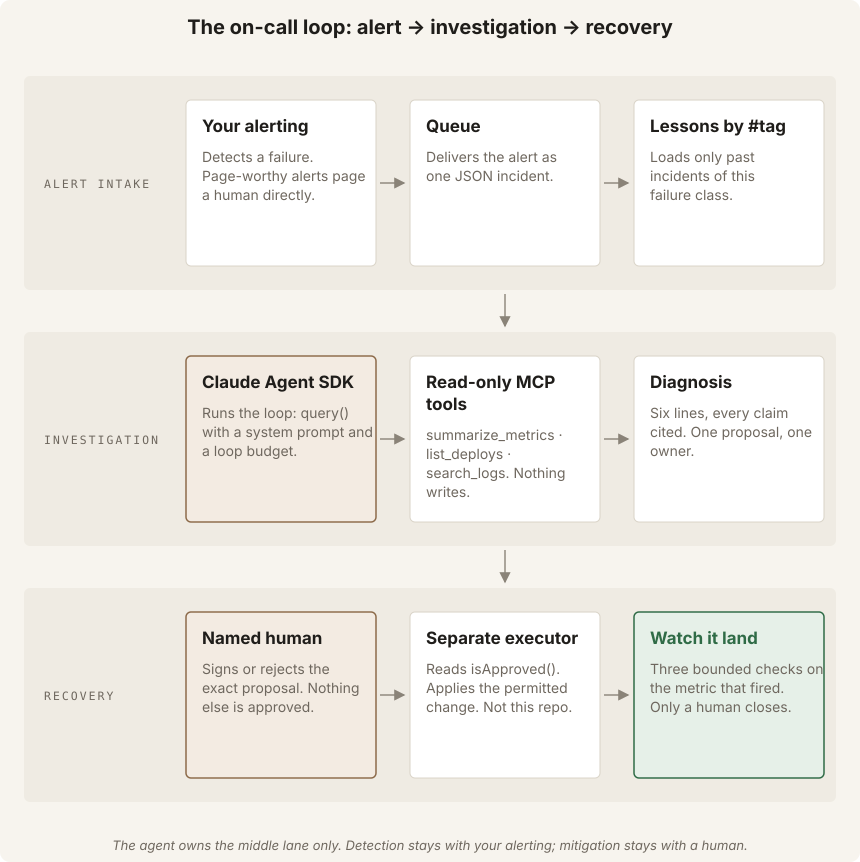

# SRE on-call lab — Workshop 5 (AI-native SDLC)

In this lab you build an AI first responder for a small checkout service, with
an optional coding assistant such as Claude Code, or by hand. An alert fires. The agent reads the telemetry,
the deploy history and the logs. It posts one diagnosis with a reference
behind every claim, and it proposes ONE next step. A named human decides.
After the human acts, the agent watches the metric and reports if the fix
landed.

The agent **cannot** roll back, scale, flip a flag or page anyone. That is the
design: the agent gathers evidence, proposes, verifies and communicates;
humans decide what to mitigate and when.

Everything runs on your own machine. All data is fictional.



## The scenario

| Part | What it is | Where |
| --- | --- | --- |
| **Checkout shop** | a mock checkout API with a demo storefront and fault buttons | `http://127.0.0.1:4310` (health: `/health`) |
| **Traffic** | steady checkouts against the shop | the lab terminal |
| **Console** | the on-call desk: incidents, chat with the agent, approve/execute/resolve buttons, a JSON API | `http://127.0.0.1:4320` |
| **Hub** | the participant card with the live next step | `http://127.0.0.1:4320/hub` |
| **Chaos** | your lever to break the shop: a bad deploy, slow latency or errors | `npm run chaos -- deploy v2.15.0 --mode bad-deploy`, or a fault button in the shop |

`npm start` runs the shop, the traffic and the console together. Breaking the
shop is always a separate action: you choose when.

The reference incident is **INC-1001** (`fixtures/incidents/bad-deploy.json`):
the checkout error rate jumps after a deploy. The tests and the bench replay
it from fixtures. When you break the live shop, the console's listener opens a
new incident (`INC-<number>`) after the error rate stays above 2% or p95 above
2000 ms for about 5 minutes (1 minute with `npm start -- --fast`). The agent is
never the detector.

## Set up and run

You need **Git** and **Node.js 22 or newer**. A coding assistant such as Claude
Code is optional; the workshop works by hand. No API key: the agent runs
offline by default, with a scripted investigator on the same tools and data.
Its output demonstrates the pipeline; it is not model evidence.

```bash
git clone https://github.com/RyanLisse/sre-oncall-agent.git
cd sre-oncall-agent
npm run checkpoint -- start                    # current committed starter copy
cd .lab/checkpoints/start
npm start -- --fast                           # checks, installs, starts the lab
```

Keep that terminal open; Ctrl+C stops only processes started by that launcher.
Use a second terminal for the rest. If you use Claude Code, start it there
(`claude`) and run `/status` to see the guard and progress hooks from
`.claude/settings.json`.

| Command | What it does |
| --- | --- |
| `npm run hub` | open the participant card (live when the lab runs) |
| `npm run chaos -- deploy v2.15.0 --mode bad-deploy` | break the shop on purpose |
| `npm run checkpoint -- core-2` | current-HEAD copy with the fail-closed A8 gate; your files untouched |
| `npm run checkpoint -- core-3` | solved current source in `.lab/checkpoints/`, your files untouched |
| `npm run doctor` | preflight check |
| `npm run demo` | the whole loop on a bad deploy, about 2 minutes, no console |
| `npm run progress` | which assignments already have file evidence |

## The assignment: three core tasks

| Core | You do |
| --- | --- |
| **1 · Investigate the evidence** | Break the shop, let the console raise the incident, check every reference in the diagnosis against the data. |
| **2 · Build a change safely and test it** | Rebuild the read-only `list_deploys` tool test-first; prove it with the tests, the bench and the trace. |
| **3 · Judge the recovery** | Rebuild the approval gate, approve with your name, read the recovery checks, then close or stop. |

The steps, with what you should see and what to do when you are stuck, are on
**[CARD.md](CARD.md)**. The facilitator run sheet is **[FACILITATOR.md](FACILITATOR.md)**;
**[WORKSHOP.md](WORKSHOP.md)** is the workshop overview.
Working alone? Follow **[SOLO.md](SOLO.md)**. Optional depth (intent, spec,
your own guard rule, a bench case, the git gate, a hackathon intent) is at the
bottom of the card.

Historical `w5-core-*` tags are archived references only. The current
safety-tested starter is generated from committed `HEAD` by `npm run checkpoint`.

## The file flow

Each step of the AI SDLC leaves one file behind: `intent.md` → `docs/spec.md`
→ `docs/plan.md` → `PROGRESS.md` (append-only: `npm run progress:note -- "…"`)
→ `REVIEW.md`.

## The rules

- **Local only.** Everything runs on your machine. The agent has no network
  access: the guard hook denies network calls.
- **Push nothing.** Commit locally if you like, but do not push branches, open
  pull requests or deploy anything. The guard hook denies `git push`.
- **Humans decide.** The agent proposes; a named human approves, executes and
  closes. The agent may not sign approvals, edit hooks, edit `.claude/`, or
  rewrite `PROGRESS.md`.
- **No secrets in files.** You do not need an API key for this lab.
