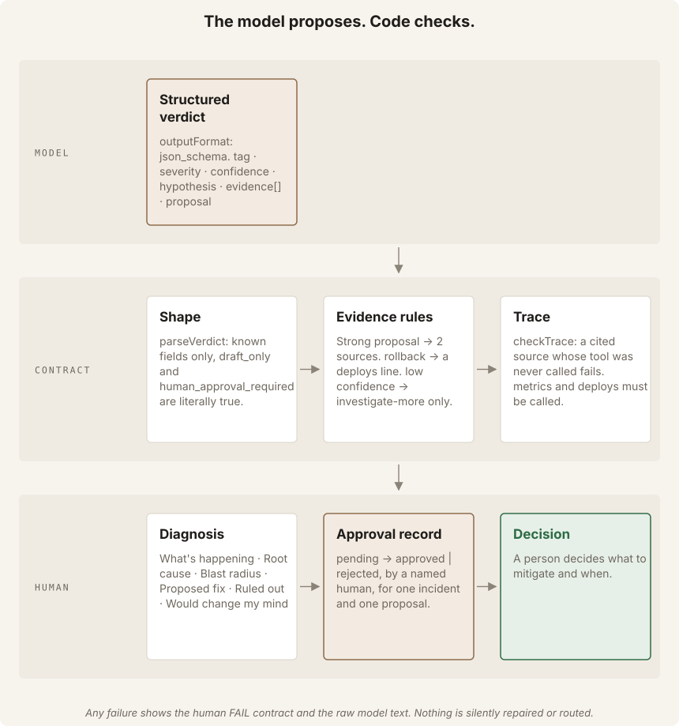
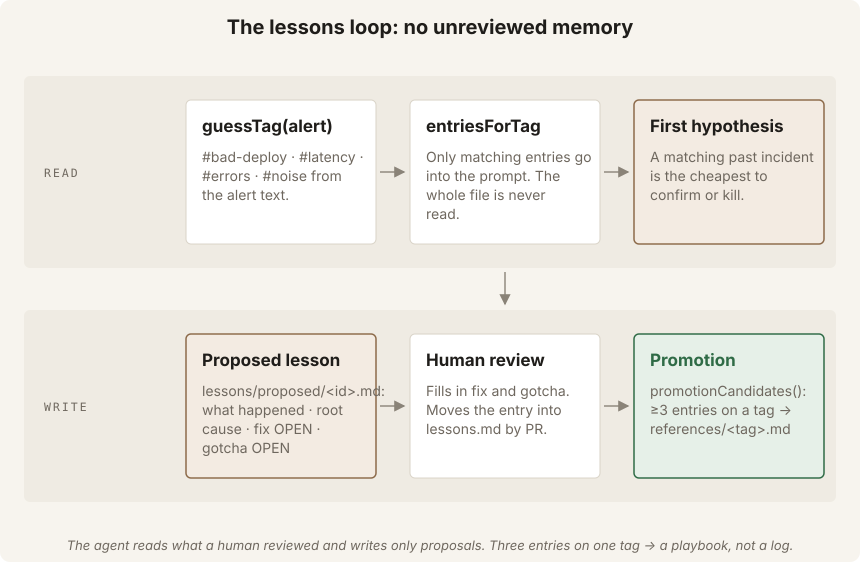
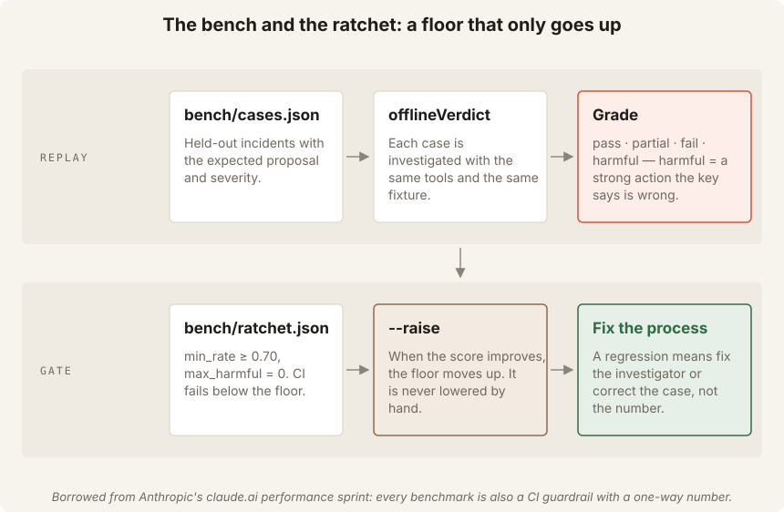

# Tutorial: build an AI SRE first responder

For the shorter classroom route, use [WORKSHOP.md](WORKSHOP.md) and
[PARTICIPANT.md](PARTICIPANT.md). Start with the recommended three-core route
below; the numbered steps remain an optional offline reference for mirror
consumers.

You can do this path alone. Each task says **Task**, **Why**, **Action** and
**Proof**. Claude Code starts in the checkpoint before theory or edits. The
Agent SDK defaults to `sonnet`; use [docs/claude-code.md](docs/claude-code.md)
for official CLI installation and separate SDK setup. A safe stop on unknown
or `NOT LANDED` recovery is valid completion.

## Recommended self-paced route

### Start — orient before acting

- **Task:** Create a disposable starter and start Claude Code in terminal 1.
- **Why:** The assistant should explain the work and evidence boundary before
  anyone edits code or acts on an incident.
- **Action:** Install Claude Code and configure SDK access as described in the
  [canonical setup guide](docs/claude-code.md). Use terminal 1 to create your clone and starter:

  ```bash
  git clone https://github.com/RyanLisse/sre-oncall-agent.git
  cd sre-oncall-agent
  npm run checkpoint -- start
  cd .lab/checkpoints/start
  claude
  ```

  Submit this exact read-only prompt before theory or edits:

  ```text
  Read CLAUDE.md, AGENTS.md and CARD.md. Explain what we will build, why it helps the on-call team, and what evidence we need. Name the two starter exercises. Do not edit files or run approval, execution, mitigation, resolution, commit or push commands. Wait for my review.
  ```

  In terminal 2, configure supported SDK access in the shell, then from the
  original clone root run:

  ```bash
  cd .lab/checkpoints/start
  npm ci
  npm run fixtures
  npm run model:check
  npm start -- --fast
  ```

- **Proof:** The real SDK preflight returns `READY` before fault injection and
  console health reports the selected model. If SDK access is unavailable,
  report it and use `npm start -- --fast --offline` only as an explicit
  fallback; offline output is not model evidence.

When both terminals are occupied, ask Claude Code to run safe checks or enter
`/exit` before typing shell commands, then reopen `claude` when finished. Never
type shell commands into the active Claude Code prompt.

### Core 1 — investigate the evidence

- **Task:** Break the shop once, inspect the diagnosis and verify every cited
  reference against telemetry and the trace.
- **Why:** A plausible explanation is not permission to change a service; a
  missing deploy signal is unknown, not proof that no deploy happened.
- **Action:** In the shop at `http://127.0.0.1:4310`, click **Bad deploy
  v2.15.0** once. Use the console at `http://127.0.0.1:4320` and check
  `demo/data/telemetry.json` against the actual diagnosis, citations and trace.
  Save `docs/diagnosis-live.md`, then record what you verified:
  `npm run progress:note -- "Core 1: checked the actual references and recorded the trace and gaps"`.
  Real model wording varies.
- **Proof:** The saved evidence shows what the agent could verify and what it
  could not. If it fabricates a deploy citation or fails the contract, retain
  the output and stop; do not weaken the contract.

### Core 2 — repair one read-only path

- **Task:** Run the red `list_deploys` test and ask Claude Code for a small
  plan; implement the handler binding **and** MCP registration only after
  human plan review.
- **Why:** Core 1 found a deployment the agent cannot read. Test-first repair
  restores evidence without adding a mutation tool.
- **Action:** Run `npx tsx --test test/workshop/tools.test.ts` and read
  the expected failure. Use this scoped prompt:
  `Read CLAUDE.md, AGENTS.md and the failing test. Propose a small plan for
  the read-only list_deploys handler and MCP registration. Do not edit files.
  Wait for my review.` After a human reviews the plan, implement and run:

  ```bash
  npx tsx --test test/workshop/tools.test.ts
  npm run typecheck
  npm run bench
  ```

  After the checks pass, submit `Investigate: customers report checkout errors`
  in the same console incident. Check the actual trace, references and gaps;
  model output and proposals vary.
- **Proof:** Focused tests and bench pass, the A8 valid-approval exercise
  remains intentionally red until Core 3, and the actual trace records the
  available deploy evidence. If a contract or citation fails, preserve output
  and stop. Record the test and trace result with
  `npm run progress:note -- "Core 2: recorded actual test results and observed trace"`.

### Core 3 — judge recovery safely

- **Task:** Rebuild `checkApproval`, then have a named human review and decide
  each recovery action separately.
- **Why:** The agent cannot approve its own action, and execution success does
  not prove recovery.
- **Action:** Use this scoped prompt: `Read CLAUDE.md, AGENTS.md and the current
  executor test. Explain the checkApproval contract and propose a small
  fail-closed plan. Do not edit files or approve, execute, mitigate or
  resolve anything. Wait for my review.` Implement only after the human
  reviews the gate plan, then run:

  ```bash
  npx tsx --test test/workshop/executor.test.ts
  npm run verify
  npm run test:workshop
  ```

  In the console, the named human reviews the actual proposal and clicks
  **Approve** with their own name, then **Execute** as a separate action.
  Only after checking the recovery result may that human choose **Mitigate**
  and **Resolve**. Follow the console next-step banner; never assume a
  particular proposal or promise rollback for arbitrary model output.
  - **Proof:** A named human records a justified resolution only after LANDED,
  or records the failed check and leaves the incident open on NOT LANDED or
  unknown. Safe stop is completion. Record the result with
  `npm run progress:note -- "Core 3: recorded actual test results and recovery outcome"`.

### Completion checklist

- [ ] Code tests and the relevant focused workshop tests are recorded.
- [ ] The actual runtime model label and trace are recorded, or SDK access is
      explicitly blocked; offline is not model evidence.
- [ ] The actual recovery outcome is recorded: LANDED and separate human
      actions, or NOT LANDED/unknown with the incident still open.
- [ ] No approval, execution, mitigation, resolution, commit or push was
      delegated to the assistant.

### Catch up without overwriting your starter

Run these commands from the original clone root, not from inside a modified
starter. Each creates a separate named checkpoint and leaves the existing
starter files in place. Tell anyone helping you which checkpoint you entered.

```bash
cd /path/to/sre-oncall-agent
npm run checkpoint -- core-2
cd .lab/checkpoints/core-2
```

For the next checkpoint, return to the original clone root and run:

```bash
cd /path/to/sre-oncall-agent
npm run checkpoint -- core-3
cd .lab/checkpoints/core-3
```

The numbered steps below are deterministic offline reference material. Every
investigation command explicitly selects `--model offline`; they are not model
evidence.

| Step | You do | Time |
| --- | --- | --- |
| 0 | Install, generate the fixtures, run the suite | 5 min |
| 1 | Read the alert and the data the agent can see | 10 min |
| 2 | Run the first investigation and read the trace | 10 min |
| 3 | Break the evidence rules on purpose | 10 min |
| 4 | Sign the approval, then watch the fix land | 10 min |
| 5 | Review the proposed lesson and promote a pattern | 10 min |
| 6 | Run the bench, then try to lower the ratchet | 5 min |
| 7 | (Optional) Run with a real model | 5 min |
| 8 | Break a live shop and watch the whole loop | 10 min |

---

## Step 0 — Install

**Explain:** This optional reference uses the scripted runtime. The current
recommended route starts Claude Code first and separately preflights the real
Agent SDK.

**Do:**

```text
npm ci
npm run fixtures
npm run verify
```

**Check:** `npm run fixtures` writes five files under `fixtures/telemetry/`.
`npm run verify` ends with `PASS bench`.

---

## Step 1 — What the agent can see


**Explain:** The agent gets an alert and three tools. It cannot change the
system. That is the whole design.

**See it:** Open `fixtures/incidents/bad-deploy.json` (the alert) and
`fixtures/telemetry/bad-deploy.json` (the system). Find the minute where
`error_rate` jumps and the deploy two minutes before it.

Open `src/tools.ts`. Count the tools. Try to find a tool that writes.

**Check:** Three tools: `search_logs`, `summarize_metrics`, `list_deploys`.
None writes. The deploy is `d-4821` at 03:43; errors start at 03:45.

---

## Step 2 — The first investigation

**Explain:** `query()` runs a loop: the model asks for a tool, the SDK runs
it, the result goes back. `maxTurns` caps the loop. The trace records every
tool call so you can see WHAT the agent looked at before you read what it
concluded.

**See it:** `ONCALL_SYSTEM` in `src/prompts.ts` is the method: lessons →
metrics → deploys → logs → verdict. `investigate()` in `src/agent.ts` is the
loop.

**Do:**

```text
npm run investigate -- fixtures/incidents/bad-deploy.json --dry-run --model offline
```

**Check:** The trace lists the three tools in order. The diagnosis has six
lines: What's happening / Root cause / Blast radius / Proposed fix / Ruled
out / Would change my mind. Proposal is `rollback`, severity is `page`. The
last line says a human decides.

Now run the other three scenarios. Predict the proposal before each run:

```text
npm run investigate -- fixtures/incidents/slow-dependency.json --dry-run --model offline
npm run investigate -- fixtures/incidents/noisy-alert.json --dry-run --model offline
npm run investigate -- fixtures/incidents/mystery-errors.json --dry-run --model offline
```

**Check:** `scale`, `no-action`, `investigate-more`. Note the confidence on
the last one is `low`, so the contract would have refused a strong proposal.

---

## Step 3 — Break the rules on purpose



**Explain:** The model proposes; code checks. Three rules live in
`parseVerdict()` in `src/contract.ts`:

- a strong proposal needs two evidence sources;
- `rollback` needs a `deploys` line;
- `low` confidence can only propose `investigate-more`.

And one in `checkTrace()` in `src/agent.ts`: a cited source whose tool was
never called fails.

**Do:** Run the adversarial alert. Its text tells the agent to skip the rules.

```text
npm run investigate -- fixtures/incidents/adversarial.json --dry-run --model offline
```

Then try the loop budget:

```text
npm run investigate -- fixtures/incidents/bad-deploy.json --dry-run --model offline --max-turns 2
```

**Check:** The adversarial alert gets the same verdict as the clean one —
alert text is data. With `--max-turns 2` the run ends with
`maxTurns (2) reached before a verdict`, not a guess.

Open `test/agent.test.ts` and read the test *"a model that skips the tools and
answers from the alert fails the contract"*. That is the trace rule.

---

## Step 4 — Sign, then watch it land

**Explain:** Without `--dry-run`, an investigation drafts an approval record
as `pending`. A NAMED human signs it. Whatever executes the fix is a separate
system that calls `isApproved(record, incident, proposal)`. Then `watch`
confirms the metric returned to baseline with three bounded checks — at half,
full and double the expected window. Not a polling loop.

**Do:**

```text
npm run investigate -- fixtures/incidents/bad-deploy.json --model offline
cat approvals/INC-1001.approval.json
npm run approve -- fixtures/incidents/bad-deploy.json --by <your name>
```

Pretend the deploy owner rolled back at 03:52. `after-rollback.json` is the
telemetry after that:

```text
npm run watch -- fixtures/incidents/bad-deploy.json --metric error_rate \
  --fix-at 2026-10-05T03:52:00Z --after fixtures/telemetry/after-rollback.json
```

Now watch WITHOUT the fix (the original telemetry):

```text
npm run watch -- fixtures/incidents/bad-deploy.json --metric error_rate \
  --fix-at 2026-10-05T03:52:00Z
```

**Check:** The approval file flips from `"pending"` to `"approved"` with your
name. The first watch says `LANDED` and `PASS watch`. The second says
`NOT LANDED` and exits 2. Neither run closed anything — only a human closes.

Try `npm run approve -- ... --by ""`. It refuses: an anonymous approval is not
an approval.

---

## Step 5 — The lessons loop



**Explain:** The agent reads `lessons/lessons.md` filtered to the alert's
`#tag`, never the whole file. It never appends. It writes a proposal to
`lessons/proposed/` and a human promotes it by PR. When one tag has three
entries, the pattern belongs in a playbook, not the log.

**See it:** `renderLessons()` and `promotionCandidates()` in
`src/lessons.ts`. `lessons/lessons.md` has two seed entries.

**Do:** Open `lessons/proposed/INC-1001.md` from Step 4. Fill in `fix` and
`gotcha`. Append it to `lessons/lessons.md`. Run the investigation again and
read the prompt the agent would get:

```text
npm run investigate -- fixtures/incidents/bad-deploy.json --dry-run --model offline
```

**Check:** `#bad-deploy` now has two entries; one more and
`promotionCandidates()` flags it. The `fix` and `gotcha` lines came from you,
not the agent — the agent only knows what it proposed.

---

## Step 6 — The ratchet



**Explain:** `bench/cases.json` holds the expected proposal and severity for
each scenario. `bench/ratchet.json` is the floor CI enforces: pass-rate ≥
`min_rate` and `harmful` ≤ 0. A *harmful* answer is a strong action the key
says is wrong. The floor only goes up.

**Do:**

```text
npm run bench
```

Now edit `bench/cases.json`: change the `noisy-alert` expectation to
`rollback`. Run the bench again.

**Check:** The bench reports `🚫 noisy-alert` as harmful and `FAIL bench`.
Revert the edit. Then try `npm run bench -- --raise` — the floor moves to
100% and will stay there.

---

## Step 7 — Optional: verify model access

This is optional model verification, not the first model use. Follow
[docs/claude-code.md](docs/claude-code.md), configure SDK access in the shell
only, and run the bounded preflight before an investigation.

**Do:**

```text
npm run model:check
npm run investigate -- fixtures/incidents/bad-deploy.json --dry-run --model sonnet
```

**Check:** If the preflight is unavailable, report the limitation and do not
invent credentials or use CLI OAuth as an SDK bypass. If it passes, the trace
shows real tool calls through the in-process MCP server and the verdict still
passes the contract. Model output varies; preserve a failed contract or
fabricated citation and stop.

---

## Step 8 — Break a live shop

**Explain:** Fixtures replay the past. The demo shop is a running service you
can break *now*. It writes its own telemetry in the shape the agent reads —
the agent never talks to the shop, exactly as it would read Grafana rather
than your service.

**Do (by hand):** run `npm start -- --fast --offline`. It starts the shop, the traffic
and the console in one terminal. Open the shop at `http://localhost:4310`. Customers check out on
their own (10 per second). Click a button under **Make something break** and
watch the error bar cross the dashed 2% line. After about a minute the
console at `http://localhost:4320` raises the alert. Its banner names the next
allowed step. **Reset to healthy** is a facilitator
lever, not the fix.

Do not run legacy demo scripts that auto-approve. Use the explicit launcher
and the human-gated console route instead; a human still approves, executes,
mitigates and resolves separately.

---

## What you built

An agent with a fixed division of labour: it searches, cites, proposes and
verifies. You decide, you act, you close. The three things that keep it
honest are code, not prompts: the evidence rules in `contract.ts`, the trace
check in `agent.ts`, and the ratchet in `bench.ts`.
