# Assignment scenarios and expected results

Use this guide beside [CARD.md](../CARD.md), which contains the exact actions
and commands. Examples show the shape of a result, not evidence that you
completed an assignment. Record your own observations and human decisions.

Choose [WSL or PowerShell](platforms.md) before setup. Keep both terminals in
the same environment. Claude Code stays local; SDK access is checked separately.

## Document and terminal examples

These are screenshots of teaching examples. They are not captured Claude
responses, executed test results, accepted plans or published PRs.

### Open the assistant in the starter

**Scenario:** You are the developer of the checkout SRE agent. Open your own unfinished copy before you ask Claude to change it.

**Start:** The original clone exists. No checkpoint is being reused or overwritten.

**Expected:** Claude Code is open in .lab/checkpoints/start. /status shows the approved account, not proof of runtime SDK access.

**Stop:** Stop if login fails or the folder is wrong. Do not share account details or credentials in screenshots.

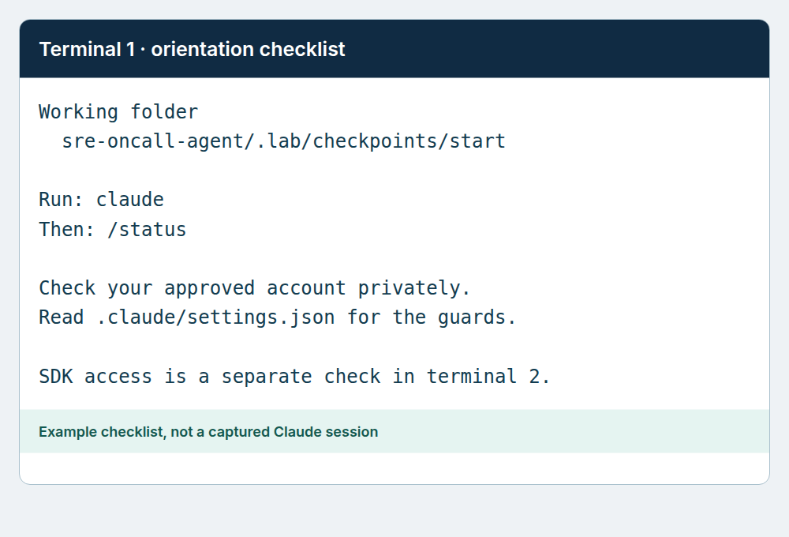

*Example checklist, not a captured Claude session.*

### Check the assistant's understanding

**Scenario:** The on-call engineer needs trustworthy evidence, not a confident guess. Check that Claude understands the two repairs before it writes code.

**Start:** Claude Code is open in the unfinished starter. No code edits are permitted yet.

**Expected:** An explanation of the two repairs, required evidence and human decisions. Compare the answer with CARD.md.

**Stop:** Stop if Claude proposes shop changes, approves its own work or starts editing.

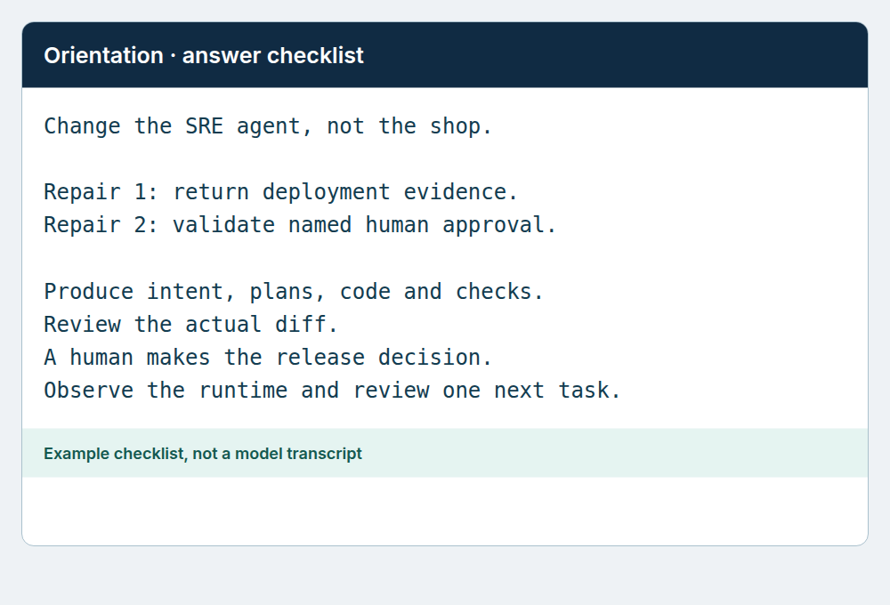

*Example checklist, not a model transcript.*

### Find the missing evidence

**Scenario:** Customers report checkout failures after a bad deployment. The on-call engineer can see errors, but the starter returns no deployment records.

**Start:** Start with a healthy shop and an empty console. Inject one bad deploy at the next step, then inspect that incident.

**Expected:** The trace shows an empty list_deploys result. Missing evidence is a gap, not proof that no deployment occurred.

**Stop:** Stop on fabricated citations or a failed contract. Preserve the output instead of forcing a rollback proposal.

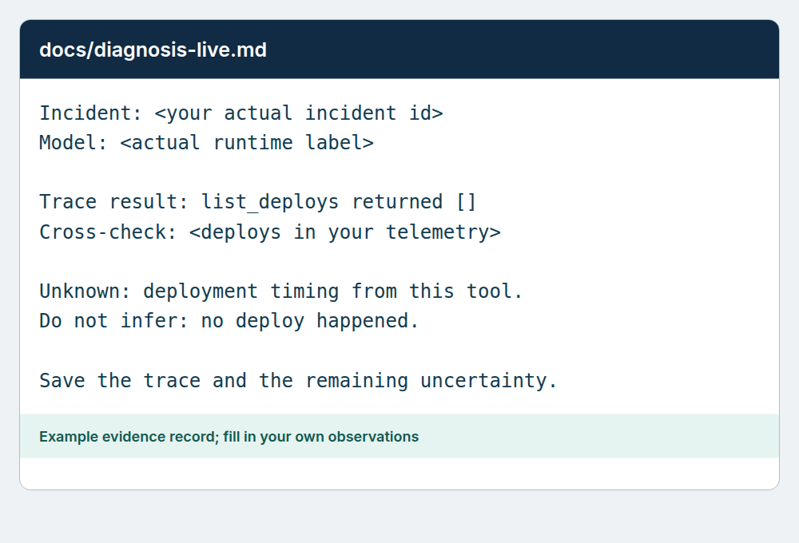

*Example evidence record; fill in your own observations.*

### Describe the change before the solution

**Scenario:** The empty deployment result blocks a reliable diagnosis. You need a small, testable change that also keeps runtime actions behind human approval.

**Start:** You have compared the trace with telemetry and recorded the missing signal.

**Expected:** A draft intent names the on-call engineer, both repairs, observable checks and the read-only boundary.

**Stop:** Do not build from a vague goal such as make the agent better. Reject invented evidence.

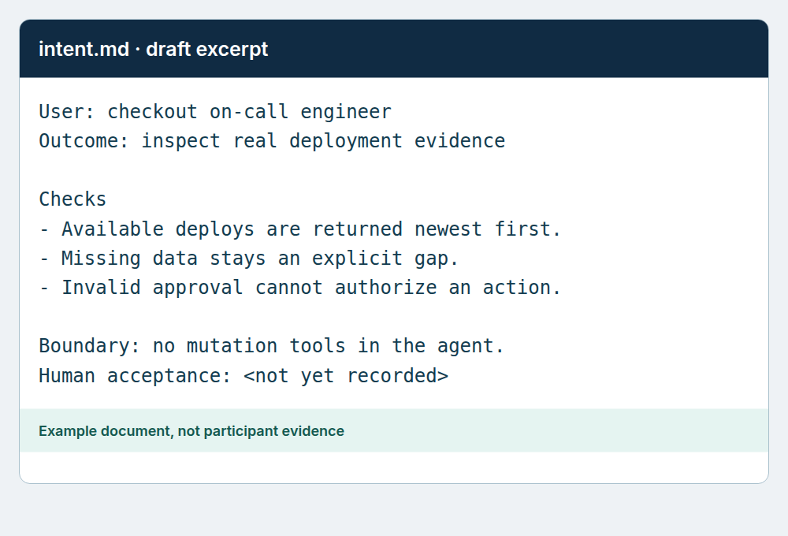

*Example document, not participant evidence.*

### Accept observable requirements

**Scenario:** Claude has drafted an intent. You decide whether another person could prove each check, before any implementation begins.

**Start:** The draft intent covers both repairs and cites your checked observation.

**Expected:** Your name, decision, reason and remaining question are recorded in the intent.

**Stop:** If scope or evidence is unclear, request a revision. A model cannot accept its own draft.

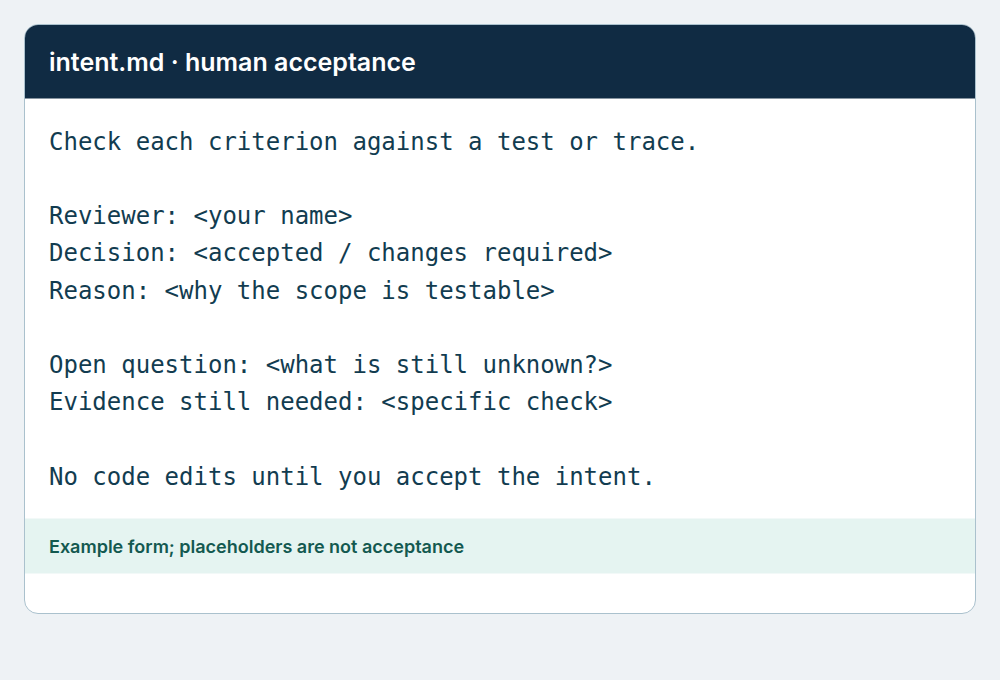

*Example form; placeholders are not acceptance.*

### Keep the unfinished code for comparison

**Scenario:** The checkpoint was cut from solved code. Without a baseline, restoring the solution can leave no useful repair diff.

**Start:** Your intent is accepted. The two starter cuts are still present.

**Expected:** Your branch is fix/w5-core. The workshop-base commit contains only src/tools.ts and src/executor.ts.

**Stop:** Do not overwrite a branch or include secrets, intent edits or unrelated files in the baseline.

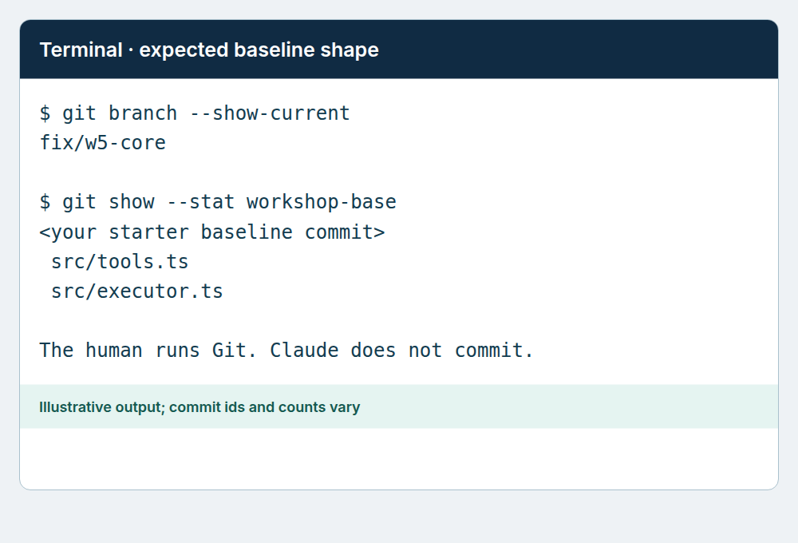

*Illustrative output; commit ids and counts vary.*

### Review the tool plan before implementation

**Scenario:** The tool test fails because the handler returns no records. Ask for the smallest repair, not a new tool architecture.

**Start:** The intent and baseline exist. You can explain the failing tool assertion.

**Expected:** A plan names the handler, checks, risk, rejected alternative and human review decision.

**Stop:** Reject a plan that weakens tests, changes the contract or adds mutation tools. Review the gate plan separately later.

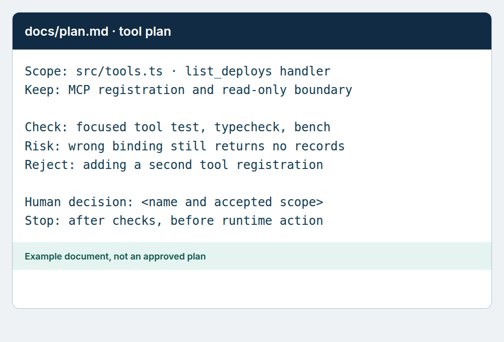

*Example document, not an approved plan.*

### Prove the deployment tool repair

**Scenario:** The on-call engineer needs the deployment records that the starter hides. Repair the handler without changing its registration.

**Start:** You have accepted the tool plan. The focused tools test is red.

**Expected:** Both tool assertions pass after repair. The gate exercise is still unfinished, so this is not release-ready.

**Stop:** If the handler still returns [], inspect the binding. Do not weaken the test or count a solved checkpoint as your work.

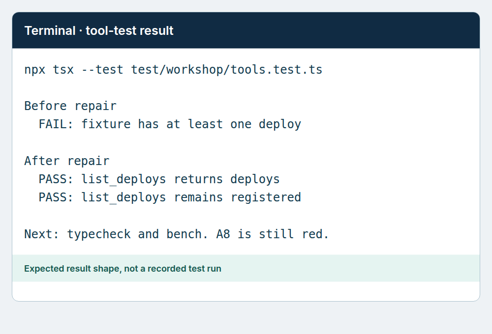

*Expected result shape, not a recorded test run.*

### Compare the same incident before and after

**Scenario:** A green tool test does not show what the real model used. Investigate the same incident again and inspect the new trace.

**Start:** The tool repair is saved. Keep the shop and traffic running; let the console reload itself.

**Expected:** The trace contains deployment records. Check cited ids and timestamps against your telemetry; model wording and proposals may differ.

**Stop:** Preserve fabricated references or contract failures. Do not restart the shop or require a rollback proposal to get a pass.

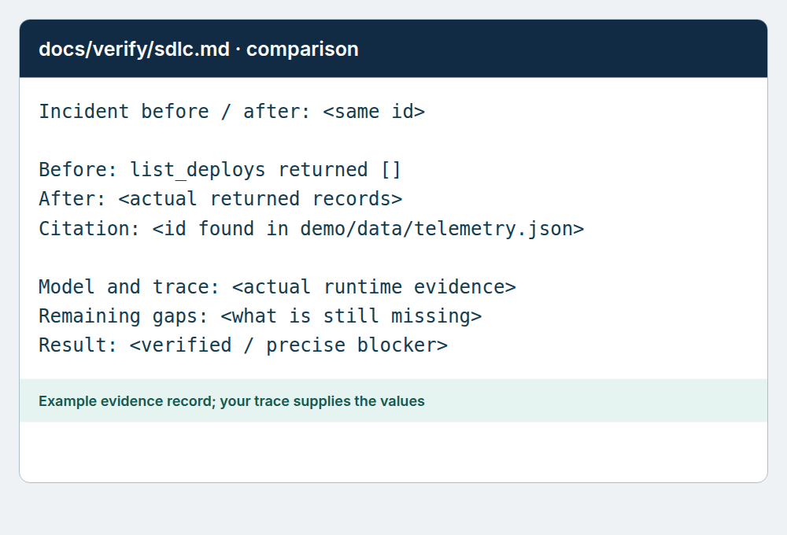

*Example evidence record; your trace supplies the values.*

### Keep human permission specific

**Scenario:** A valid human approval must work, but an approval for another incident or proposal must not. The starter refuses everything.

**Start:** Review the separate gate plan. The valid-approval assertion is red before repair.

**Expected:** The gate accepts the valid named approval in tests and still refuses missing, pending or mismatched approval.

**Stop:** A green gate test is not runtime approval. Do not click Approve or Execute during this repair.

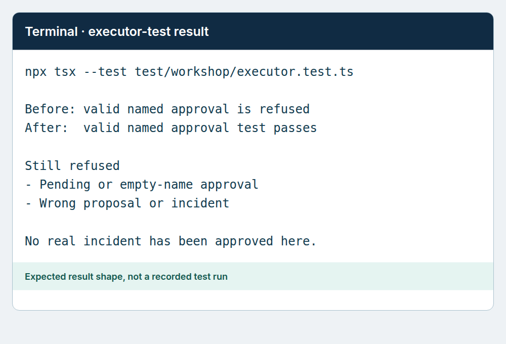

*Expected result shape, not a recorded test run.*

### Record checks, not a done label

**Scenario:** Both repairs are now present. Check the combined change before a human reviews or publishes it.

**Start:** The focused tool and gate tests pass. No runtime action is authorized by these results.

**Expected:** The required commands exit successfully. The evidence record separates code checks from real-model observations.

**Stop:** Keep failing output. Do not mark the change ready or replace model evidence with the scripted bench.

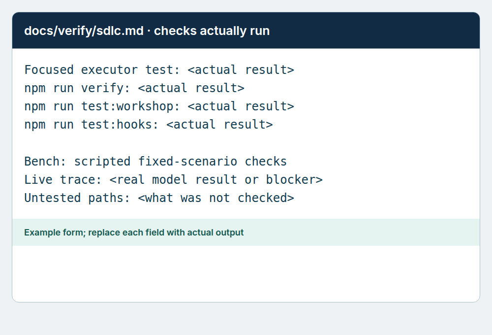

*Example form; replace each field with actual output.*

### Judge the code against the intent

**Scenario:** Tests pass, but the change might still exceed the plan. Review the actual diff and verify Claude's findings yourself.

**Start:** Both repairs and required checks are complete. Inspect untracked files before reviewing the diff.

**Expected:** A meaningful diff against workshop-base and a human decision linked to findings, risks and unchecked paths.

**Stop:** An empty repair diff is not proof. Resolve findings and rerun affected checks before release.

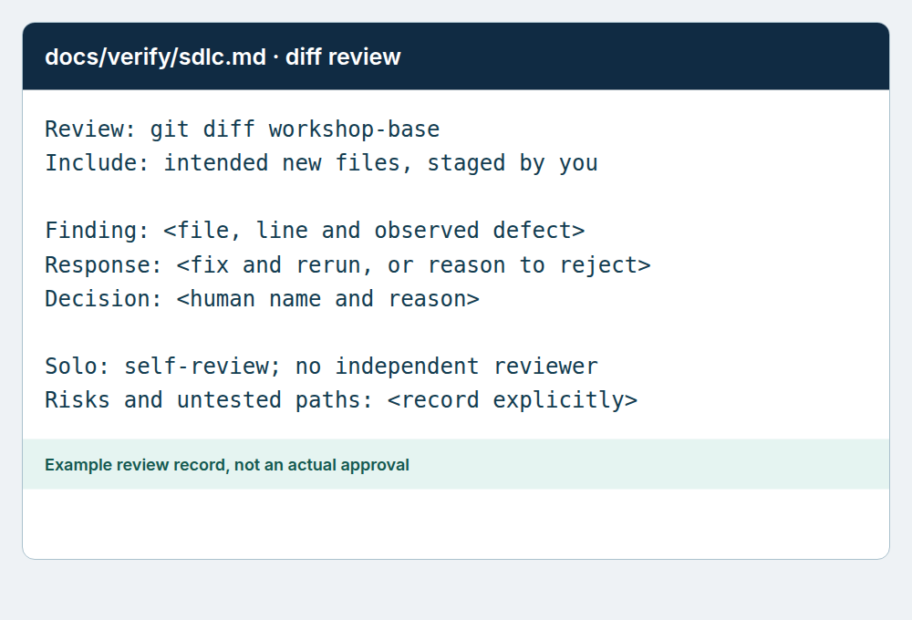

*Example review record, not an actual approval.*

### Publish only with the required checks

**Scenario:** You have a reviewed change. A missing reviewer or repository permission is a release blocker, not permission to bypass the gate.

**Start:** The human has reviewed the diff and current evidence. Claude may prepare PR text, not publish it.

**Expected:** A learner-repo PR from fix/w5-core into workshop-base, or an explicit RELEASE BLOCKED record with a next action.

**Stop:** Do not push to the upstream training repo or bypass required review. A local reload is not a production release.

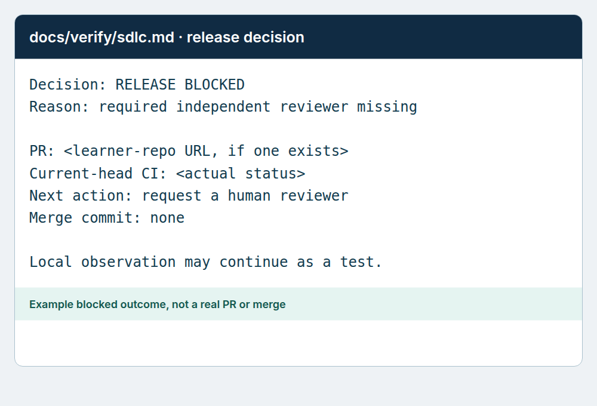

*Example blocked outcome, not a real PR or merge.*

### Use the actual result for the next task

**Scenario:** Recovery may fail even after a successful execution. Use the failed measurement or another observed limit to propose one next change.

**Start:** The runtime outcome or blocker is recorded. Keep an unresolved incident open.

**Expected:** One proposed task has evidence, an observable acceptance check and a human review decision.

**Stop:** Do not invent successful recovery or implement the next task without a new accepted scope.

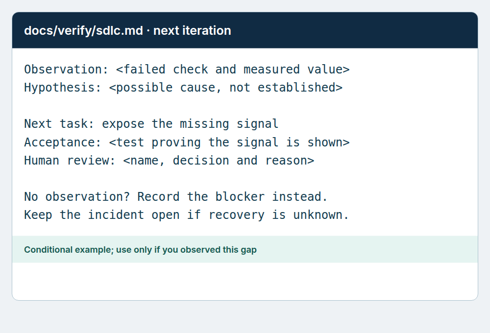

*Conditional example; use only if you observed this gap.*

### Resume without inventing completion

**Scenario:** You continue without a facilitator. Preserve your own code and evidence, and name the limits of self-review.

**Start:** Read SOLO.md and locate the last step you actually verified.

**Expected:** A resume note names the last verified step, next check and any borrowed checkpoint code.

**Stop:** Do not overwrite your work or copy another run's approvals. A required independent reviewer still blocks release.

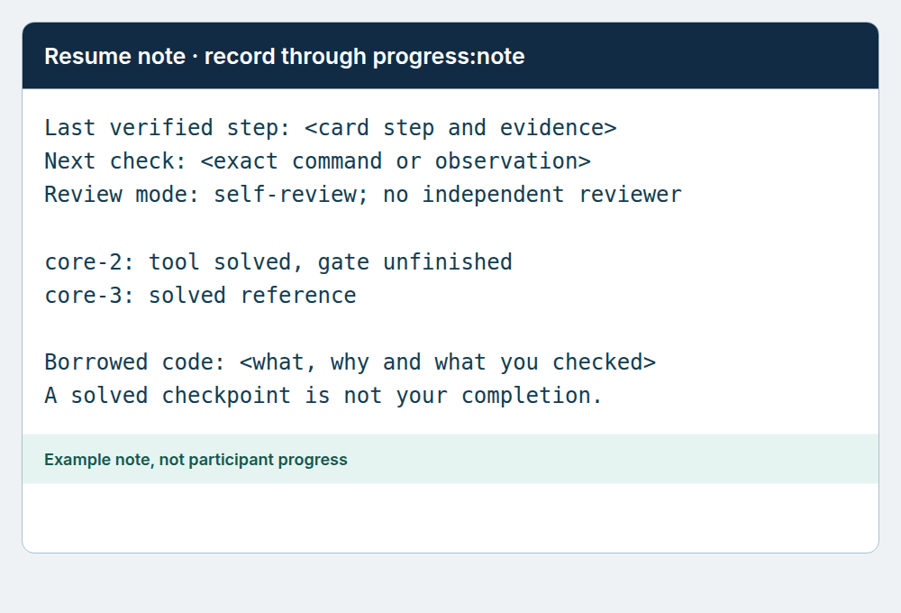

*Example note, not participant progress.*

## Shop and console screen references

These are unmodified local browser captures from 2026-10-21. They use
scripted offline runtime output with real local shop traffic, not live-model
evidence. The LANDED/resolved images and NOT LANDED image are different runs.
Compare the controls and state, not ids, wording, scores or timings.

### A healthy starting point

**Scenario:** The shop provides the observations for your AI-SDLC task. Begin without an existing incident.

**Start:** A fresh starter, successful SDK preflight, launcher and traffic running. Expect Active 0 and History 0.

**Stop:** Stop if ports are busy or model preflight fails. Do not kill an unknown process.

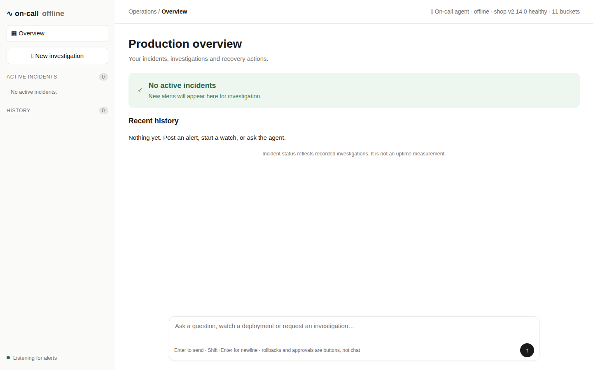

### One deliberate fault

**Scenario:** Customers now see checkout errors after one bad deployment. Wait for the fixed detector to open an incident.

**Start:** The healthy shop was running. Click Bad deploy v2.15.0 once; --fast detection takes about one minute.

**Stop:** Do not inject a second fault or reset an incident while comparing evidence.

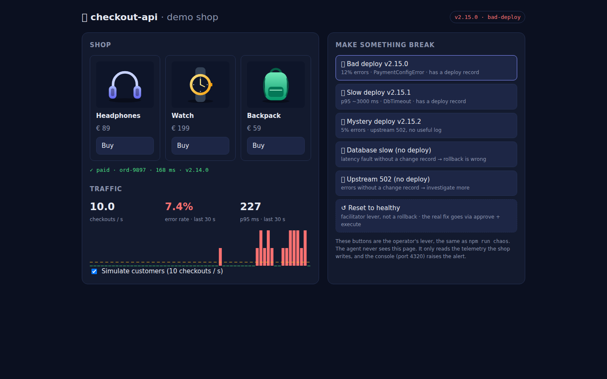

### A diagnosis is not permission

**Scenario:** Read the diagnosis and compare its references with telemetry. The starter deployment tool has a gap.

**Start:** One incident is open. Inspect the actual trace; an empty tool result must remain a gap.

**Stop:** Reject invented references. Do not demand the same proposal as this older reference image.

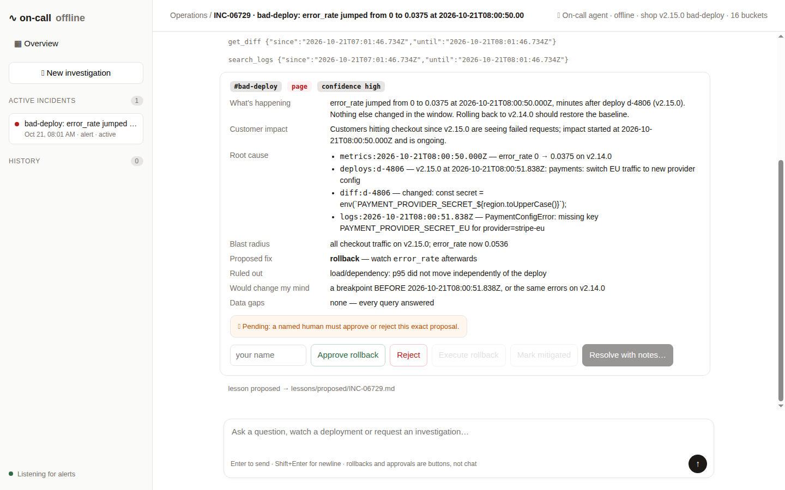

### Mutation requests are refused

**Scenario:** The question path is read-only. A request to roll back is refused rather than executed.

**Start:** Read the existing boundary; keep runtime approval separate from chat or test results.

**Stop:** Do not rephrase a mutation to bypass the grammar.

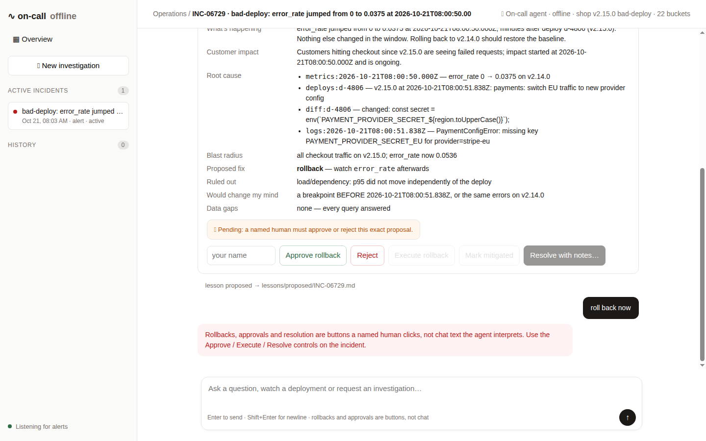

### Approval and execution are separate

**Scenario:** A human reviews the actual allowed proposal. Named approval does not itself execute the action.

**Start:** Code has been reviewed. Evidence supports this proposal for this incident. A human makes each decision.

**Stop:** If data is missing or the proposal is unsupported, stop instead of approving for the sake of the exercise.

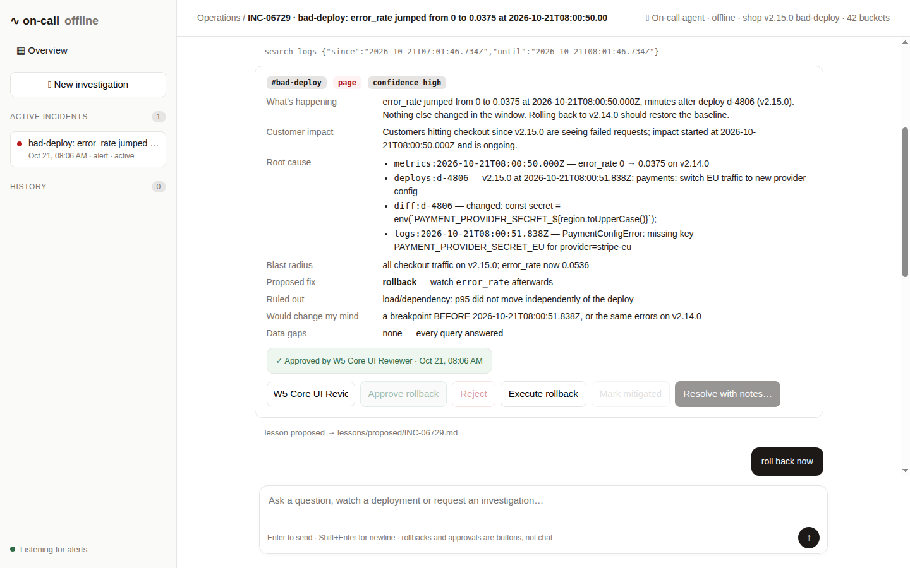

### Recovery not confirmed

**Scenario:** An execution can finish without sufficient recovery evidence. Keep the failed measurements.

**Start:** One separately approved execution has completed. Read all half/full/double checks.

**Stop:** NOT LANDED or unknown: keep the incident open. No retry just to obtain a green result.

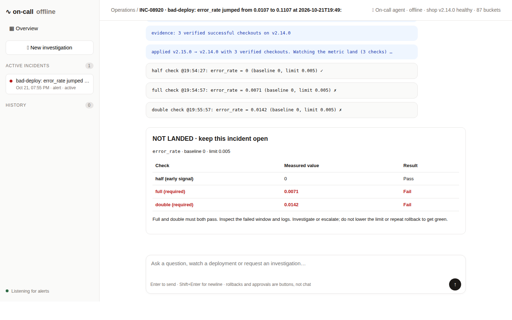

### Recovery confirmed in a different run

**Scenario:** Passing recovery checks allow a human closure decision; the system does not close itself.

**Start:** This retained image is a different earlier run. All its checks passed; do not copy that outcome into your run.

**Stop:** If any of your checks fail or are unknown, use the NOT LANDED branch instead.

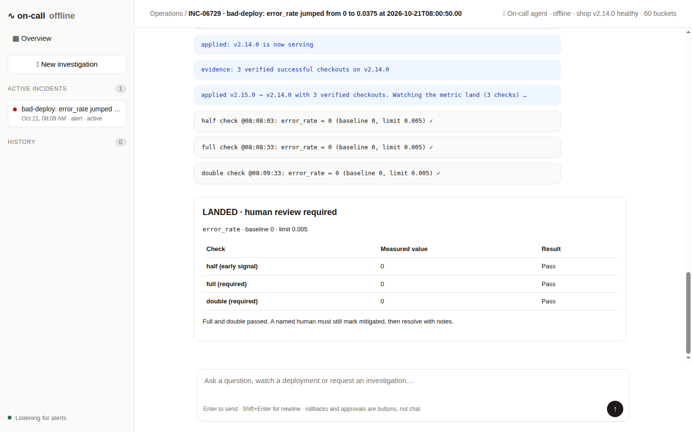

### Human closure persists

**Scenario:** A human recorded mitigation and resolution notes after valid recovery. The incident remains resolved on reload.

**Start:** Only follow this branch if your own recovery checks pass and a human decides to close.

**Stop:** Do not close merely because the shop looks healthy. Do not copy names, approvals or outcomes from the screenshot.

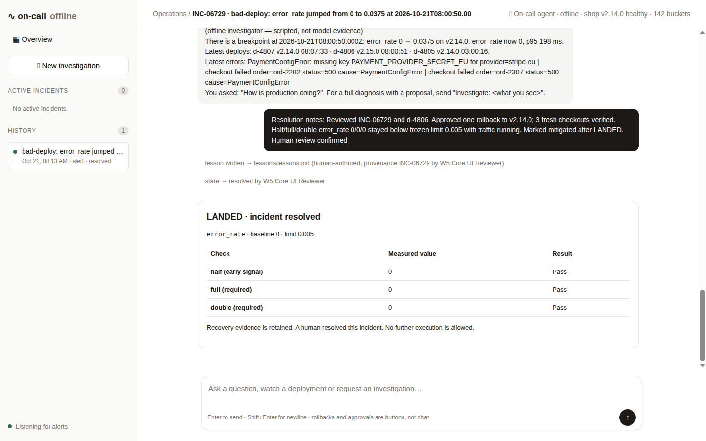

## Optional walkthroughs

The [older control-loop walkthrough](https://github.com/RyanLisse/aetherlink-classroom-slides/blob/main/assets/workshop-5/media/control-loop.mp4)
is optional background, not the current Claude Code assignment or a complete
AI-SDLC submission. Use the card for the current route.

Image provenance and limitations: [capture notes](https://github.com/RyanLisse/aetherlink-classroom-slides/blob/main/assets/workshop-5/README.md).
